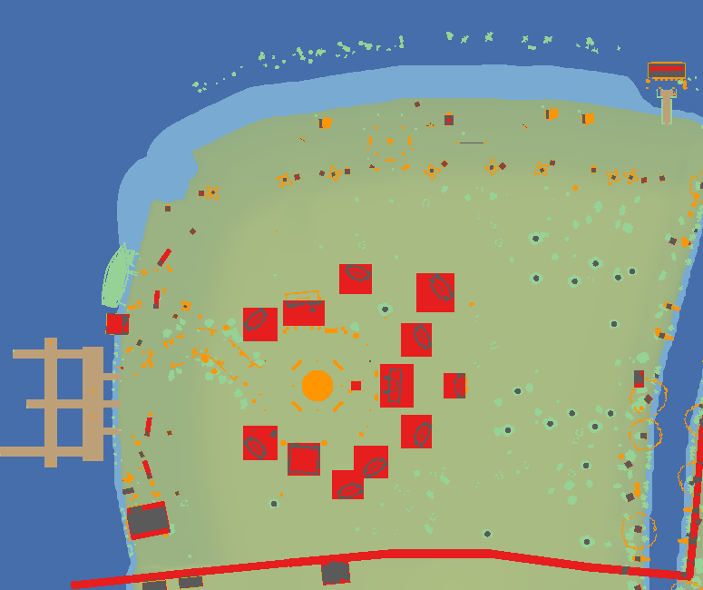
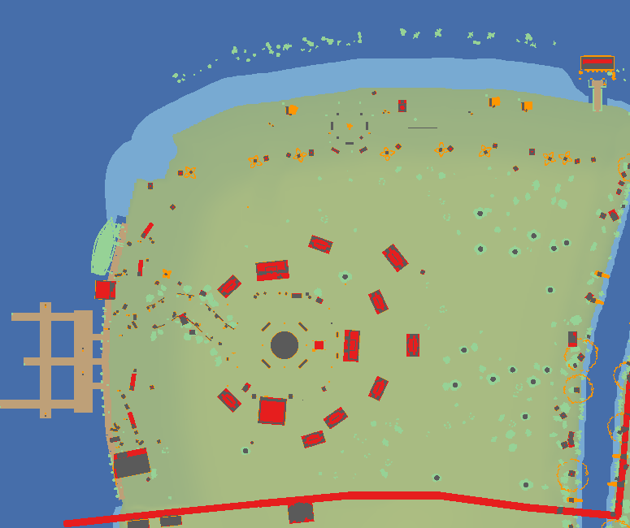
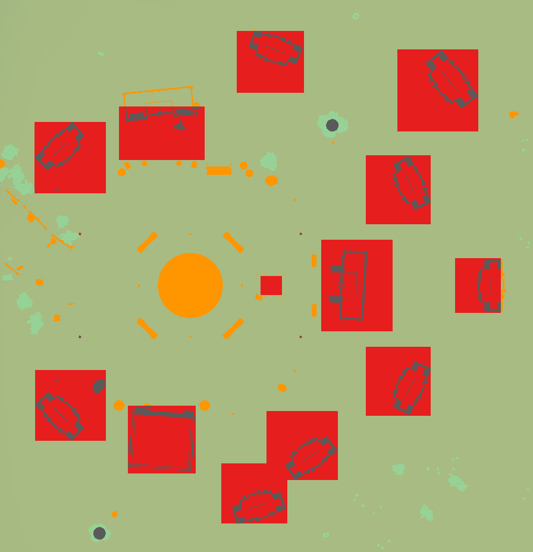
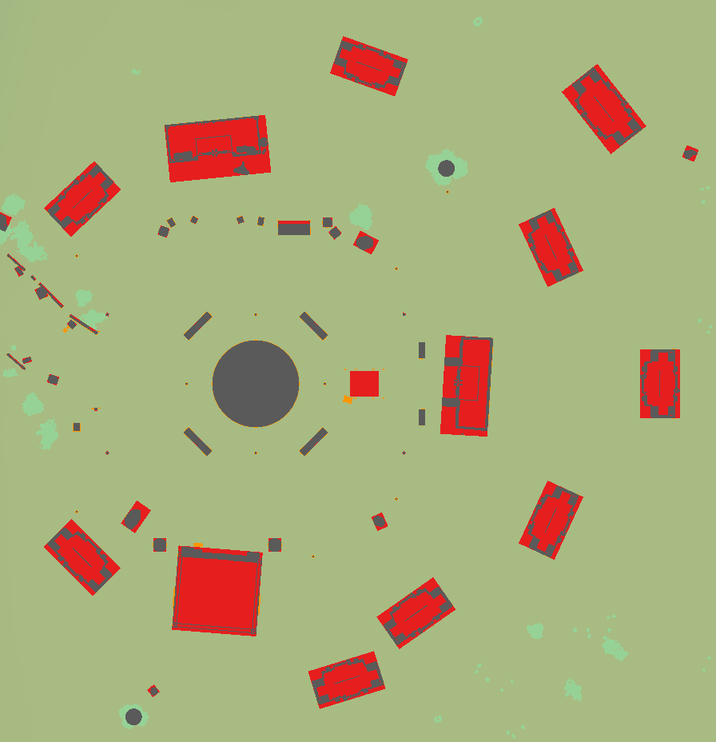
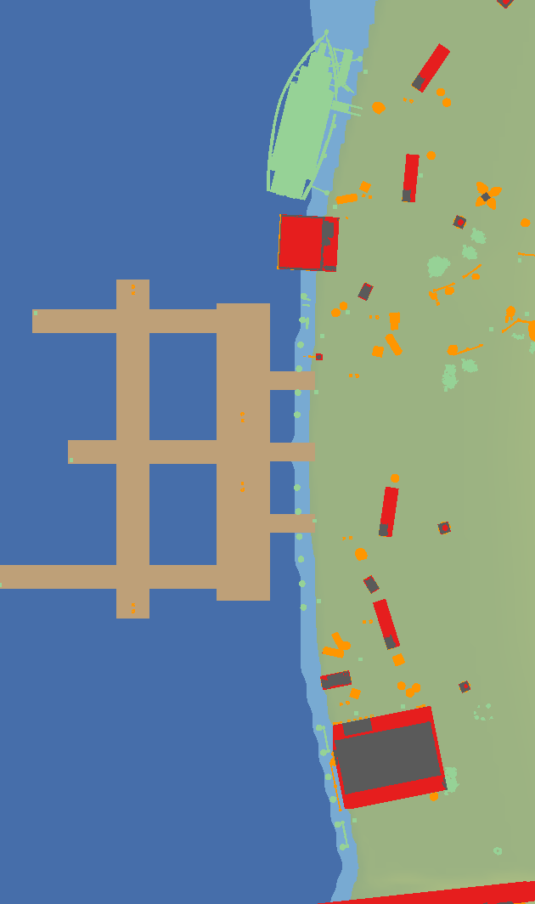
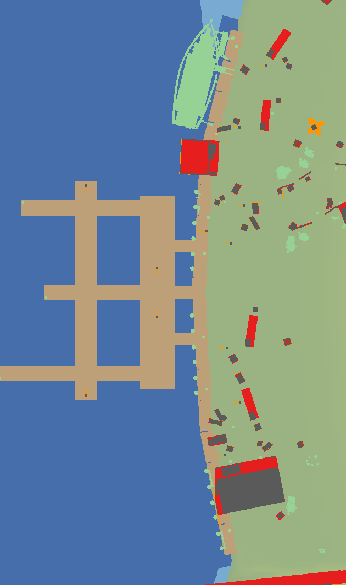
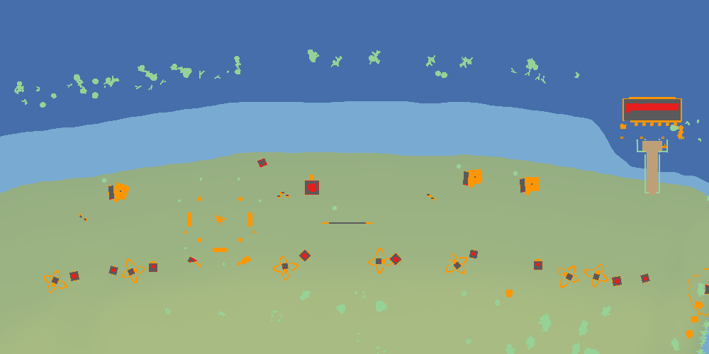
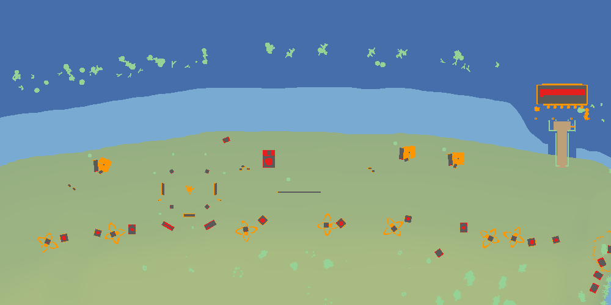

# Collision audit: the new world (lane collision, 2026-10-26)

David, after playing production: "wharf the deck near the ledge i just fall in the water"; "the hit box is weird on the
object and building sespecially, some object cant be walked through but should be, some objects can be walked through
but shouldnt, and the big buildings hit box vs actual box is not matched".

Generator: `web/lib/game/world/collisionAudit.test.ts`, skipped unless `AUDIT_OUT` names a folder
(`AUDIT_OUT=/tmp/audit npx vitest run lib/game/world/collisionAudit.test.ts`; rerun it after a repaint). It places every
object of `web/data/world` the way the game draws it (DefaultIslandWorld, NatureModels, the lamps, the deck kit), keeps
each model's triangles that reach body height (0.3 to 1.8 over its ground), and compares them with what the walker
blocks (`island.top` more than a step, 0.3, over the ground). "Before" is main at 1d9a951e; "after" is this branch.

## Renders (top-down, +x to the left and +z up, as the game's camera)

| | Before | After |
|---|---|---|
| Open area |  |  |
| Plaza |  |  |
| Wharf |  |  |
| Beach |  |  |

Grey: drawn and blocks. **Orange: drawn, should block, walked through.** **Red: blocks, nothing drawn** (red inside a
building's walls is its enclosed floor: correct). Pale green: soft things (grass, flowers, shrubs, reeds, shells,
leaves). Tan: a deck over lower ground. Blue: water (dark: water you can't wade).

## What was wrong, and the fixes

1. **The wharf's deck (shipped first, 6969b2ac).** The 34 board squares (the `deck` kind) were drawn but never walkable
   decks: the walker followed the coast's slope under their outer half and stepped into the shallows a metre before the
   drawn edge. Each square is now a deck at its tile's height, turned its own way, and the shallows within 1.5 of any
   deck (the boards, the jetty, the sushi bar) are water you can't wade, so every edge over the sea holds you. Off onto
   dry land (the boards' south end onto the sand, the bar's boardwalk end) still steps down.
2. **Props' tops were read as heights over the sea.** `PROP_TOP` is measured from a model's foot, but the walker
   compared it with the absolute ground. On the plaza (ground 3) and the wharf (ground 1) almost every prop's top was
   under the ground, so the movement sim walked through it: the fountain, benches, planters, barrels, crates, carts,
   stalls, boulders, path fences, the campfire's benches and stumps. A prop's top now stands on the ground under it.
3. **Buildings' boxes were off their walls.** The ACNH buildings stand behind their origin (turned a half turn), but
   their boxes were centred on it; and the smooth world turns each building its own way while its box was the unturned
   bound (a house at 45 degrees blocked a 7.5 x 7.5 square). Each building (the HQ, the shop, the museum, the eight
   houses, the temple; the cafe keeps its authored 5 x 5) is now its measured wall box, turned and scaled with it
   (`BUILDING_SOLID`, held to the GLBs by `propModels.test.ts`). Every door's prompt stays clear and reachable.
4. **Lamp posts were not solid.** Each post lamp now blocks a square round its post (`NEW_LAMPS[kind].post`); the hand
   lanterns stay soft.
5. **Footprints fitted to what's drawn** where they were off by more than a tenth: the volleyball net (its posts), the
   fish market (centre offset), the fruit stall, the lifeguard tower's ladder, the leaning palm, the alders, the net
   heaps, the cloth crates, the path rocks and fences, the sandcastle, the surfboards, the dock hoist's post. The
   fountain is round now (its basin).

## Left as is, on purpose

- **Soft by design:** the palms' fronds, the willows' curtains, the leaning river tree's crown, the parasols' canopies,
  the banners, the hand lanterns, the deck kit's piles, nets, rings and ladders, the shipwright's ship (all over water,
  which holds you).
- **The deck's rope fence** (rope posts and spans along the boards' water edge): not solid, but the deck's edge 0.2
  beyond it holds you.
- **The monument** blocks the roped-off site inside its rope square (stage 0).
- **The forest trees, the lighthouse, the coral and the temple** stand where you can't walk (behind the border and the
  forest edge, on the islet, under the sea).
- **The moss boulders** keep their boxes: their size also sets how far they sink into a slope (NatureModels `propY`),
  so a tighter box would move the art.
- **`rock-a`, `rock-b`, `rock-c`** are shared with the village, which stays unchanged.

## For the coordinator (not changed here)

- **The market cart model is broken:** `web/public/assets/acnh/props/market-cart.glb` has two of its four meshes with
  no triangles (index count 0) and the fourth with 648 indices for 2605 vertices, so only about a third of the cart
  draws (the red bars on the wharf render). Its blocker covers the whole cart as built. Fix the model (art), not the box.
- **The campfire is walked through.** Not on the lane's list either way; a fire you sit round. David's call.
- **Four plaza benches** (`bench-0` to `bench-3`, no model) and the four `study` markers draw nothing and block nothing,
  but `benchSeat` still seats you at the invisible benches.
- **The village has the same building offsets** (the shop's box reaches 1.8 in front of its walls, the HQ's 2 behind
  them); left unchanged by the lane's rule.

## The table

Drawn sizes and blockers are in the model's own units, before the object's scale. "Blocked": the share of what it draws
at body height that stops a body. "Phantom": blocked area (square units) in the 1 u ring round it with nothing of it
drawn there (a neighbour's blocker counts too, and so does a building's enclosed floor). "top from 0": before, the
prop's top was read as a height over the sea (fix 2).

### Solid things

| Object (kind:model) | n | | Drawn at body height (w x d @ centre) | Blocker before | Blocked / phantom before | Blocker after | Blocked / phantom after |
|---|---|---|---|---|---|---|---|
| barrier:forest-edge | 2 | solid | 5.40 x 2.73 @ -0.05, 0.33 | barrier box | 93% / 9.93 | barrier box | 93% / 9.93 |
| barrier:rockslide | 1 | solid | 6.24 x 4.76 @ -0.05, 0.40 | barrier box | 99% / 16.63 | barrier box | 99% / 16.63 |
| barrier:unbuilt-bridge | 2 | solid | 2.90 x 2.11 @ 0.04, 0.12 | barrier box | 100% / 6.15 | barrier box | 100% / 6.15 |
| bench:log-bench | 3 | solid | 1.90 x 0.48 | 0.95 x 0.24, top from 0 | 0% / 0 | 0.95 x 0.24 | 97% / 0.02 |
| campfire: | 1 | solid | 1.23 x 1.18 @ -0.07, -0.13 | none | 0% / 0 | none | 0% / 0 |
| house:chalet-brown | 3 | solid | 4.70 x 2.67 @ 0.00, 1.19 | 2.5 x 2.1, unturned bound | 100% / 26.82 | turned 2.35 x 1.34 @ 0, 1.2 | 98% / 11.25 |
| house:chalet-red | 3 | solid | 4.70 x 2.67 @ 0.00, 1.19 | 2.5 x 2.1, unturned bound | 92% / 26.89 | turned 2.35 x 1.34 @ 0, 1.2 | 98% / 11.18 |
| house:chalet-yellow | 2 | solid | 4.70 x 2.67 @ 0.00, 1.19 | 2.5 x 2.1, unturned bound | 100% / 29.73 | turned 2.35 x 1.34 @ 0, 1.2 | 98% / 11.03 |
| kit:rope-post | 3 | solid | 0.22 x 0.20 | none | 0% / 1.41 | none | 21% / 1.42 |
| kit:rope-span | 2 | solid | 2.00 x 0.04 | none | 0% / 3.05 | none | 29% / 3.29 |
| lamp:branchPost | 2 | solid | 0.70 x 0.22 @ 0.26, 0.00 | none | 0% / 0 | post 0.18 | 62% / 1.14 |
| lamp:camp | 2 | solid | 0.43 x 0.16 @ 0.17, 0.00 | none | 0% / 0 | post 0.08 | 12% / 0.15 |
| lamp:village | 11 | solid | 0.18 x 0.18 | none | 18% / 0.71 | post 0.08 | 100% / 0.02 |
| lamp:wharf | 11 | solid | 0.79 x 0.24 @ 0.27, 0.00 | none | 0% / 0.13 | post 0.15 | 52% / 0.29 |
| lamp:woodPost | 3 | solid | 1.05 x 0.26 @ 0.40, 0.00 | none | 0% / 0 | post 0.14 | 44% / 0.73 |
| landmark:cafe | 1 | solid | 5.12 x 5.06 @ 0.00, -0.19 | 2.5 x 2.5, unturned bound | 98% / 42.64 | turned 2.5 x 2.5 | 92% / 36.81 |
| landmark:hq | 1 | solid | 5.86 x 2.80 @ -0.17, -0.75 | 3.5 x 2.65, unturned bound | 100% / 47.55 | turned 2.93 x 1.4 @ -0.17, -0.75 | 96% / 21.37 |
| landmark:monument | 1 | solid | 3.21 x 2.72 @ 0.06, -0.23 | 1.1 x 1 | 0% / 4.4 | 1.1 x 1 | 0% / 4.4 |
| landmark:museum | 1 | solid | 4.70 x 2.67 @ 0.00, 1.19 | 2.5 x 2.1, unturned bound | 100% / 40.06 | turned 2.35 x 1.34 @ 0, 1.2 | 99% / 15.26 |
| landmark:oracle | 1 | solid | 6.76 x 2.91 @ 0.00, 2.07 | 3.4 x 1.7, unturned bound | 50% / 10.97 | turned 3.38 x 1.46 @ 0, 2.08 | 95% / 12.12 |
| landmark:shop | 1 | solid | 6.01 x 3.41 @ -0.20, 1.79 | 3.25 x 1.8, unturned bound | 64% / 25.69 | turned 3.01 x 1.71 @ -0.2, 1.79 | 98% / 27.89 |
| prop:banner-pole | 2 | solid | 0.72 x 0.16 | 0.1 x 0.1, top from 0 | 0% / 0 | 0.1 x 0.1 | 55% / 0.18 |
| prop:barrel | 10 | solid | 9.70 x 9.70 | 4.85 x 4.85, top from 0 | 0% / 0.17 | 4.85 x 4.85 | 92% / 0.79 |
| prop:beach-cooler | 3 | solid | 0.66 x 0.44 | 0.33 x 0.22, top from 0 | 0% / 0.96 | 0.33 x 0.22 | 75% / 0.96 |
| prop:beach-lounger | 3 | solid | 0.68 x 1.90 | 0.34 x 0.95, top from 0 | 85% / 0.14 | 0.34 x 0.95 | 85% / 0.43 |
| prop:beach-parasol | 3 | solid | 1.96 x 1.96 | 0.1 x 0.1, top from 0 | 3% / 1.21 | 0.1 x 0.1 | 4% / 1.47 |
| prop:crate | 4 | solid | 1.78 x 0.59 | 0.91 x 0.3, top from 0 | 0% / 0 | 0.91 x 0.3 | 87% / 1.1 |
| prop:crate-cloth | 2 | solid | 0.82 x 0.82 | 0.35 x 0.35, top from 0 | 0% / 0.28 | 0.41 x 0.41 @ 0.05, -0.03 | 86% / 0.68 |
| prop:crate-net | 1 | solid | 1.41 x 0.84 @ -0.07, 0.00 | 0.7 x 0.4, top from 0 | 0% / 0 | 0.7 x 0.4 | 84% / 0.58 |
| prop:dock-hoist | 1 | solid | 1.45 x 0.30 @ 0.58, 0.00 | 0.28 x 0.28, top from 0 | 40% / 0.13 | 0.15 x 0.15 | 30% / 0 |
| prop:firewood-stack | 1 | solid | 1.88 x 0.69 | 0.95 x 0.46, top from 0 | 0% / 0 | 0.95 x 0.46 | 99% / 0.57 |
| prop:fish-crate | 2 | solid | 0.70 x 0.74 | 0.36 x 0.42, top from 0 | 0% / 0.51 | 0.36 x 0.42 | 84% / 0.9 |
| prop:fish-market | 1 | solid | 8.92 x 6.09 @ 0.36, 0.75 | 4.4 x 3.6, top from 0 | 98% / 21.44 | 4.46 x 3.05 @ 0.36, 0.75 | 99% / 12.48 |
| prop:fish-rack | 1 | solid | 2.04 x 0.74 | 1.02 x 0.37, top from 0 | 41% / 0.35 | 1.02 x 0.37 | 97% / 0.9 |
| prop:flag-pole | 4 | solid | 0.12 x 0.12 | 0.12 x 0.12, top from 0 | 92% / 0.03 | 0.12 x 0.12 | 92% / 0.03 |
| prop:flower-planter | 2 | solid | 1.28 x 0.44 | 0.62 x 0.22, top from 0 | 0% / 1.65 | 0.62 x 0.22 | 74% / 0 |
| prop:flower-pot | 2 | solid | 0.50 x 0.51 | 0.24 x 0.24, top from 0 | 0% / 2.6 | 0.24 x 0.24 | 75% / 0.02 |
| prop:fruit-barrel | 3 | solid | 0.76 x 0.76 | 0.38 x 0.38, top from 0 | 0% / 0.06 | 0.38 x 0.38 | 94% / 0.6 |
| prop:fruit-crate | 2 | solid | 0.63 x 0.44 | 0.32 x 0.22, top from 0 | 0% / 1.84 | 0.32 x 0.22 | 75% / 0.29 |
| prop:fruit-stall | 1 | solid | 2.54 x 1.14 | 1.4 x 0.6, top from 0 | 0% / 0.48 | 1.27 x 0.57 | 94% / 0.55 |
| prop:lifeguard-tower | 1 | solid | 2.04 x 2.89 @ 0.00, 0.43 | 1.02 x 1.02, top from 0 | 78% / 1.75 | 1.02 x 1.45 @ 0, 0.42 | 99% / 2.95 |
| prop:lighthouse | 1 | solid | 13.78 x 13.98 @ 0.00, 0.10 | 9 x 9, top from 0 | 100% / 10.84 | 9 x 9 | 100% / 10.84 |
| prop:market-cart | 4 | solid | 1.96 x 1.33 @ 2.79, 0.33 | 3.77 x 1.03, top from 0 | 93% / 1.78 | 3.77 x 1.03 | 93% / 1.9 |
| prop:market-sign | 1 | solid | 0.62 x 0.50 | 0.31 x 0.25, top from 0 | 0% / 0 | 0.31 x 0.25 | 71% / 0 |
| prop:moss-boulder-a | 13 | solid | 1.01 x 0.86 @ 0.06, -0.05 | 0.65 x 0.5, top from 0 | 17% / 0.88 | 0.65 x 0.5 | 99% / 1.58 |
| prop:moss-boulder-b | 4 | solid | 1.58 x 1.01 @ -0.24, -0.14 | 1.05 x 0.65, top from 0 | 20% / 2.1 | 1.05 x 0.65 | 99% / 2.66 |
| prop:net-heap | 3 | solid | 1.06 x 0.91 @ -0.08, -0.01 | 0.7 x 0.5, top from 0 | 0% / 0.85 | 0.53 x 0.46 @ -0.08, -0.02 | 95% / 0.24 |
| prop:palm-lean | 3 | solid | 1.18 x 0.94 @ 0.12, 0.00 | 0.42 x 0.42, top from 0 | 69% / 0.24 | 0.59 x 0.47 @ 0.12, 0 | 100% / 0.68 |
| prop:palm-short | 5 | solid | 0.91 x 0.90 | 0.4 x 0.4, top from 0 | 86% / 0.26 | 0.4 x 0.4 | 86% / 0.26 |
| prop:palm-small | 9 | solid | 2.54 x 2.67 @ 0.20, -0.05 | 0.3 x 0.3, top from 0 | 21% / 0.69 | 0.3 x 0.3 | 21% / 0.72 |
| prop:palm-tall | 7 | solid | 1.05 x 1.04 | 0.45 x 0.45, top from 0 | 79% / 0.43 | 0.45 x 0.45 | 79% / 0.43 |
| prop:path-rock-cluster | 3 | solid | 0.39 x 0.33 @ -0.15, 0.01 | 0.36 x 0.26, top from 0 | 0% / 0 | 0.2 x 0.17 @ -0.15, 0.02 | 95% / 1 |
| prop:path-rock-low | 7 | solid | 0.43 x 0.51 @ -0.07, 0.04 | 0.3 x 0.3, top from 0 | 0% / 0 | 0.22 x 0.26 @ -0.07, 0.05 | 93% / 0.56 |
| prop:path-rock-slab | 4 | solid | 0.36 x 0.18 | 0.2 x 0.12, top from 0 | 0% / 0 | 0.2 x 0.12 | 96% / 0.68 |
| prop:planter-bench | 4 | solid | 2.64 x 0.56 | 1.3 x 0.28, top from 0 | 0% / 0 | 1.3 x 0.28 | 86% / 0 |
| prop:plaza-fountain | 1 | solid | 9.04 x 9.04 | 4 x 4, top from 0 | 0% / 0 | round r 4.52 | 97% / 0.04 |
| prop:river-tree-alder | 6 | solid | 0.92 x 1.19 @ -0.15, 0.08 | 0.65 x 0.65, top from 0 | 99% / 2.22 | 0.46 x 0.6 @ -0.15, 0.08 | 97% / 1.82 |
| prop:river-tree-lean | 8 | solid | 3.89 x 1.24 @ 0.74, -0.03 | 0.6 x 0.6, top from 0 | 45% / 2.31 | 0.6 x 0.6 | 46% / 2.55 |
| prop:river-tree-oak | 4 | solid | 1.50 x 1.46 | 0.75 x 0.75, top from 0 | 99% / 0.5 | 0.75 x 0.75 | 99% / 1.2 |
| prop:river-tree-willow | 10 | solid | 7.65 x 7.41 @ 0.43, -0.30 | 0.7 x 0.7, top from 0 | 35% / 6.29 | 0.7 x 0.7 | 35% / 6.69 |
| prop:round-planter | 2 | solid | 1.04 x 1.04 | 0.52 x 0.52, top from 0 | 0% / 1.21 | 0.52 x 0.52 | 92% / 0.45 |
| prop:rustic-fence-a | 5 | solid | 2.58 x 0.25 | 1.25 x 0.08, top from 0 | 0% / 0.01 | 1.29 x 0.12 @ 0.01, 0.02 | 82% / 2.34 |
| prop:rustic-fence-b | 8 | solid | 1.86 x 0.21 @ 0.06, 0.03 | 0.85 x 0.08, top from 0 | 0% / 0 | 0.93 x 0.1 @ 0.06, 0.03 | 82% / 0.88 |
| prop:rustic-post | 1 | solid | 0.45 x 0.21 @ 0.11, 0.04 | 0.07 x 0.07, top from 0 | 0% / 0 | 0.22 x 0.11 @ 0.1, 0.05 | 58% / 1.04 |
| prop:sandcastle | 1 | solid | 1.10 x 0.75 @ -0.06, 0.05 | 0.55 x 0.5, top from 0 | 98% / 0.54 | 0.55 x 0.38 @ -0.06, 0.05 | 96% / 0.29 |
| prop:sell-barrel | 1 | solid | 2.56 x 1.14 @ 0.00, 0.06 | 1.25 x 0.6, top from 0 | 96% / 0.56 | 1.25 x 0.6 | 96% / 1.18 |
| prop:shop-cart | 2 | solid | 0.87 x 0.56 | 0.44 x 0.28, top from 0 | 94% / 0.39 | 0.44 x 0.28 | 94% / 0.41 |
| prop:stump-seat | 4 | solid | 0.49 x 0.50 | 0.3 x 0.3, top from 0 | 0% / 0 | 0.3 x 0.3 | 100% / 0.11 |
| prop:surfboard-a | 3 | solid | 0.50 x 0.28 @ -0.12, -0.10 | 0.2 x 0.1, top from 0 | 38% / 0.11 | 0.25 x 0.14 @ -0.12, -0.1 | 90% / 0.18 |
| prop:surfboard-b | 2 | solid | 0.48 x 0.28 @ 0.11, -0.09 | 0.2 x 0.1, top from 0 | 41% / 0.14 | 0.24 x 0.14 @ 0.11, -0.09 | 88% / 0.21 |
| prop:surfboard-c | 2 | solid | 0.44 x 0.32 @ -0.11, -0.07 | 0.2 x 0.1, top from 0 | 44% / 0.11 | 0.22 x 0.16 @ -0.11, -0.07 | 67% / 0.2 |
| prop:sushi-bar | 1 | solid | 9.00 x 7.15 @ -0.06, 1.81 | 4 x 1.5, top from 0 | 64% / 7.45 | 4 x 1.5 | 64% / 7.45 |
| prop:tackle-shop | 1 | solid | 4.65 x 5.68 @ 0.03, 0.31 | 2.3 x 2.45, top from 0 | 89% / 17.96 | 2.3 x 2.45 | 89% / 18.06 |
| prop:volleyball-net | 1 | solid | 7.02 x 0.14 | 2.62 x 0.08, top from 0 | 72% / 0.5 | 3.51 x 0.08 | 99% / 0.66 |
| rock:rock-a | 2 | solid | 0.82 x 0.76 | 0.48 x 0.45, top from 0 | 0% / 0.12 | 0.48 x 0.45 | 96% / 0.29 |
| rock:rock-b | 2 | solid | 0.71 x 0.76 | 0.46 x 0.42, top from 0 | 0% / 0 | 0.46 x 0.42 | 98% / 0.28 |
| rock:rock-c | 1 | solid | 0.78 x 0.99 @ 0.10, 0.01 | 0.5 x 0.5, top from 0 | 0% / 0 | 0.5 x 0.5 | 100% / 0.48 |

### Soft things (walked through)

| Object (kind:model) | n | | Drawn at body height (w x d @ centre) | Blocker before | Blocked / phantom before | Blocker after | Blocked / phantom after |
|---|---|---|---|---|---|---|---|
| kit:dock-pile-rope | 18 | soft | 0.48 x 0.48 | none | 0% / 0.17 | none | 0% / 0.23 |
| kit:life-ring | 1 | soft | 0.96 x 0.18 | none | 0% / 0 | none | 0% / 0 |
| kit:rope-net | 2 | soft | 2.26 x 0.26 | none | 0% / 1.15 | none | 0% / 1.25 |
| kit:wharf-ladder | 1 | soft | 0.58 x 0.58 @ 0.00, 0.11 | none | 0% / 0 | none | 0% / 0 |
| lamp:hand | 30 | soft | 0.28 x 0.28 | none | 3% / 0.33 | none | 10% / 0.59 |
| prop:beach-ball-a | 1 | soft | 0.56 x 0.56 | none | 0% / 0.34 | none | 0% / 0.34 |
| prop:beach-ball-b | 2 | soft | 0.56 x 0.56 | none | 0% / 0.15 | none | 0% / 0.15 |
| prop:beach-ball-c | 1 | soft | 0.56 x 0.56 | none | 0% / 0.34 | none | 0% / 0.34 |
| prop:coral-a | 6 | soft | 0.66 x 0.49 @ 0.04, 0.07 | none | 0% / 0.06 | none | 0% / 0.06 |
| prop:coral-b | 11 | soft | 0.90 x 0.67 @ 0.08, 0.02 | none | 0% / 0.09 | none | 0% / 0.09 |
| prop:coral-c | 11 | soft | 0.85 x 0.45 @ 0.10, 0.12 | none | 0% / 0 | none | 0% / 0 |
| prop:coral-d | 11 | soft | 0.43 x 0.39 | none | 0% / 0 | none | 0% / 0 |
| prop:coral-reef-a | 5 | soft | 2.41 x 1.48 @ -0.10, 0.06 | none | 0% / 0 | none | 0% / 0 |
| prop:coral-reef-b | 3 | soft | 1.76 x 1.78 @ 0.09, 0.07 | none | 0% / 0 | none | 0% / 0 |
| prop:coral-reef-c | 4 | soft | 3.35 x 1.05 | none | 0% / 0 | none | 0% / 0 |
| prop:flower-meadow | 30 | soft | 0.77 x 1.05 @ 0.10, 0.01 | none | 1% / 0.07 | none | 1% / 0.07 |
| prop:flower-tallgrass | 19 | soft | 0.47 x 0.56 | none | 0% / 0 | none | 0% / 0.01 |
| prop:forest-tree-birch | 18 | soft | 0.36 x 0.42 | none | 0% / 0 | none | 0% / 0 |
| prop:forest-tree-broadleaf | 50 | soft | 0.76 x 0.72 | none | 0% / 0 | none | 0% / 0 |
| prop:forest-tree-cedar | 50 | soft | 4.21 x 4.33 @ -0.37, 0.46 | none | 0% / 0 | none | 0% / 0 |
| prop:forest-tree-fir | 78 | soft | 2.85 x 2.59 @ 0.01, -0.08 | none | 0% / 0 | none | 0% / 0 |
| prop:forest-tree-leaning | 8 | soft | 3.11 x 3.22 @ 0.78, -0.14 | none | 0% / 0 | none | 0% / 0 |
| prop:forest-tree-old-fir | 37 | soft | 5.40 x 5.64 @ 0.01, -0.06 | none | 0% / 0 | none | 0% / 0 |
| prop:forest-tree-sapling | 10 | soft | 0.18 x 0.18 | none | 0% / 0 | none | 0% / 0 |
| prop:forest-tree-spire | 42 | soft | 0.50 x 0.47 | none | 0% / 0 | none | 0% / 0 |
| prop:forest-tree-wide | 28 | soft | 0.86 x 0.81 | none | 0% / 0 | none | 0% / 0 |
| prop:forest-tree-young | 17 | soft | 1.64 x 1.75 @ -0.04, 0.08 | none | 0% / 0 | none | 0% / 0 |
| prop:reeds-a | 33 | soft | 1.33 x 1.36 | none | 6% / 1.51 | none | 6% / 1.66 |
| prop:reeds-b | 18 | soft | 0.85 x 0.84 | none | 6% / 1.33 | none | 5% / 1.34 |
| prop:reeds-c | 19 | soft | 2.60 x 1.37 @ 0.13, -0.08 | none | 9% / 3.06 | none | 9% / 3.13 |
| prop:river-stones-b | 11 | soft | 1.12 x 0.82 | 0.55 x 0.4, top from 0 | 87% / 2.28 | 0.55 x 0.4 | 86% / 2.24 |
| prop:shipwright-ship | 1 | soft | 14.42 x 6.94 @ 0.10, -1.76 | none | 0% / 0 | none | 0% / 1.91 |
| prop:shrub-a | 27 | soft | 1.46 x 1.40 @ 0.01, -0.07 | none | 10% / 1.11 | none | 13% / 1.34 |
| prop:shrub-b | 12 | soft | 2.00 x 1.35 @ 0.08, -0.09 | none | 0% / 0.22 | none | 1% / 0.25 |
| prop:shrub-c | 7 | soft | 1.22 x 0.98 @ -0.01, -0.09 | none | 0% / 0.08 | none | 0% / 0.29 |
| prop:shrub-d | 8 | soft | 0.62 x 0.70 @ 0.12, 0.04 | none | 0% / 0 | none | 4% / 0.62 |
| prop:shrub-e | 24 | soft | 2.21 x 1.82 | none | 9% / 1.97 | none | 11% / 2.29 |
| prop:shrub-f | 36 | soft | 1.80 x 1.09 @ -0.12, 0.02 | none | 8% / 1.25 | none | 8% / 1.31 |
| prop:sushi-bar-pier | 1 | soft | 4.40 x 7.66 @ 0.00, 7.95 | none | 0% / 0 | none | 0% / 0 |
| tree: | 18 | soft | 2.36 x 1.95 | trunk r 0.65 | 28% / 0 | trunk r 0.65 | 28% / 0.02 |
